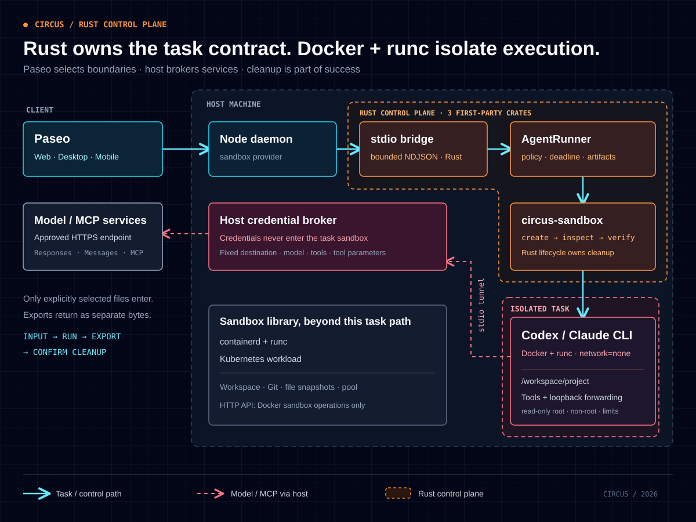

# Circus

**给 AI Agent 一个独立的工作现场。**

提交任务和文件，让 Agent 在沙箱里修改代码、运行工具，再带回可检查的产物。Circus 用 Rust 管理执行环境，用 Paseo 提供交互入口，把文件授权、资源边界、实时输出和任务结束后的回收串成一条完整链路。

[看演示](#一次任务从修复代码到取回产物) · [看架构](#架构) · [跑起来](#快速上手) · [接入 Paseo](#在-paseo-中使用) · [能力边界](#目前能做什么)

## 为什么做 Circus

Agent 开始执行命令后，应用就需要回答几件具体的事：它能读哪些文件？命令在哪里运行？模型密钥交给谁？任务失败或被停止后，谁负责收尾？

Circus 把这些问题变成调用契约：

| 你交给 Circus 的                                         | Circus 负责的                                        | 你拿回来的                                   |
| -------------------------------------------------------- | ---------------------------------------------------- | -------------------------------------------- |
| 一段任务描述、明确选择的输入文件、要导出的路径、任务期限 | 独立沙箱、受限执行、模型通道、事件流、产物读取与清理 | 文本和工具进度、文件字节、任务结果与清理状态 |

- **文件按任务授予。** 只导入选定的输入；输出独立返回，是否写回项目由调用方决定。
- **执行有明确边界。** 当前 Agent 使用 Docker + runc，禁用容器外网、只读根目录、非 root 用户，并显式配置 CPU、内存、进程数和工作区限额。
- **模型密钥留在宿主。** 容器通过受控标准流通道请求指定的 HTTPS 模型服务，真实 API key 不进入镜像、沙箱环境或工作区。
- **清理也是结果的一部分。** 只有任务完成、指定产物取回、沙箱销毁确认后才报告成功；清理未完成时保留重试入口。

## 一次任务：从修复代码到取回产物

给 Codex 一份故意写错的 `answer.py`：

```python
def add(a, b): return a - b
```

提交任务：

> 修复 `add(a, b)`，运行 Python 断言，验证 `add(20, 22) == 42` 和 `add(-2, 2) == 0`。通过后，把 `42` 和换行写入 `result.txt`。导出两个文件。

```text
导入输入 → 创建沙箱 → Codex 修改代码并执行测试 → 导出产物 → 销毁并确认
```

这条路径已使用真实 Docker、Codex 和模型网关 `gpt-5.6-sol` 完成验收：修复后的函数返回 `a + b`，`result.txt` 为 `42\n`，任务容器经独立检查确认已删除。示例的成功输出如下；模型生成的代码格式与字节数可能不同。

```text
task completed; 2 artifacts retrieved
answer.py: 28 bytes
result.txt: 3 bytes
42
```

演示时可以直接展示四件事：**输入文件、真实工具执行、导出的文件、确认回收的沙箱**。运行步骤见[快速上手](#快速上手)，验收层次见[如何验证](#如何验证)。

## 架构



[打开架构图源文件](docs/assets/architecture.svg) · [下载 HTML 展示版](docs/assets/architecture.html)（本地打开；PNG / PDF 导出工具需联网加载）

### 三层职责

| 层           | 组件                                         | 职责                                                                    |
| ------------ | -------------------------------------------- | ----------------------------------------------------------------------- |
| 交互层       | Paseo 客户端、Node daemon、sandbox provider  | 选择输入、提交任务、展示事件、停止任务、预览和下载产物                  |
| Agent 调用层 | `circus-stdio-bridge`、`circus-agent-runner` | 有界 NDJSON 协议、Codex app-server 驱动、任务期限、取消、产物与清理结果 |
| 执行层       | `circus-sandbox`                             | 统一 API、生命周期与资源回收、工作区、后端适配和运行时配置              |

Rust 调用方可以直接使用运行器或沙箱库。Codex 协议位于 Agent 调用层，沙箱核心通过 `api → lifecycle → infrastructure` 管理后端；**状态转换与销毁始终由 lifecycle 拥有**。

当前 Agent 链路使用 **Docker + runc**。沙箱库另有 containerd 与 Kubernetes workload 适配；独立 HTTP API 当前提供 Docker 沙箱操作，尚未提供 Agent 任务接口。

### 禁网的 Agent 如何访问模型

容器内的 Codex 访问本地回环转发器；模型请求经已有进程标准流传给宿主控制器，由宿主校验后访问指定的 HTTPS `/responses` 服务，再流式送回结果。Docker socket 只供宿主管理端使用。

通道限定模型、请求路径、请求和响应大小，不接受容器指定任意上游，也不转发它提供的真实认证头。因此可以允许 Agent 调用模型，同时保持容器 `network=none`。任务所需的软件依赖应预先放入镜像，运行时不能任意联网安装。

### 停止任务后，清理归谁

调用方消费事件流，并另外等待最终结果。取消只是发出请求，终止与清理是否完成由最终结果确认：

| 清理状态    | 含义                             | 调用方动作                   |
| ----------- | -------------------------------- | ---------------------------- |
| `confirmed` | 已确认沙箱回收                   | 读取任务结果；成功时取回产物 |
| `pending`   | 清理尚未完成，运行器保留所有权   | 保留任务句柄并重试清理       |
| `unknown`   | 桥接中断等故障使清理状态不可确认 | 在宿主核查任务所属资源       |

## 快速上手

先跑终端示例即可验证完整 Agent 任务，无需启动 Paseo 前端。

**准备环境：** Rust 1.99.1 / Cargo（仓库已固定工具链）、宿主 Python 3.11+、Docker CLI，以及可通过本地 socket 访问的 Linux Docker Engine + runc。需要支持 **Responses SSE 和 Codex 工具调用**的 HTTPS 模型服务；仅兼容 Chat Completions 的网关不适用。以下命令使用 **Bash**，镜像演示目标为 `linux/amd64`。

<details>
<summary>首次获取演示代码</summary>

在新目录中克隆仓库：

```bash
git clone https://github.com/BizerNotNull/circus.git
cd circus
```

已有最新主干代码可以直接从下一步开始。

</details>

### 1. 构建 Agent 镜像

在仓库根目录执行。将 endpoint 改成实际使用的本地 Linux Engine socket；构建需要联网下载依赖。

```bash
export CIRCUS_DOCKER_ENDPOINT=unix:///var/run/docker.sock

docker --host "$CIRCUS_DOCKER_ENDPOINT" build \
  --platform linux/amd64 \
  --tag circus-agent-codex:0.164.0 \
  circus-sandbox/images/codex

export CIRCUS_AGENT_IMAGE="$(docker --host "$CIRCUS_DOCKER_ENDPOINT" \
  image inspect --format '{{.Id}}' circus-agent-codex:0.164.0)"
```

镜像包含固定版本的 Codex CLI 0.164.0、Node.js，以及 Python、Git、ripgrep。运行时使用上一步获取的不可变 `sha256:` 镜像 ID。版本与构建边界见[镜像说明](circus-sandbox/images/codex/README.md)。

### 2. 配置模型并运行

替换地址和模型名，密钥在终端中隐藏输入。示例只读取显式配置，不复用个人 Codex 登录。

```bash
export CIRCUS_MODEL_BASE_URL=https://your-approved-gateway.example/v1
export CIRCUS_MODEL=your-approved-model
read -r -s -p 'Model API key: ' CIRCUS_MODEL_API_KEY
export CIRCUS_MODEL_API_KEY
printf '\n'

export CIRCUS_AGENT_PROMPT='Fix the existing answer.py add(a, b). Run Python assertions for add(20, 22) == 42 and add(-2, 2) == 0. Write 42 followed by a newline to result.txt after the tests pass.'

cd circus-sandbox
cargo run --locked -p circus-agent-runner --example codex_agent
unset CIRCUS_MODEL_API_KEY
```

示例自动导入错误的 `answer.py`，任务期限为 180 秒，导出 `answer.py` 和 `result.txt`。你会看到阶段、工具状态与最终产物摘要；文件字节返回到调用方内存，不会自动保存到宿主当前目录。

宿主 Python 不在默认路径时设置 `CIRCUS_HOST_PYTHON`；网关使用额外 CA 时设置 `CIRCUS_MODEL_CA_FILE`。故障分类、预算和自定义输入见 [Agent 运行器文档](circus-sandbox/docs/codex-agent.md)。

## 在 Paseo 中使用

Paseo 把同一任务契约变成可交互的工作流：选择文件或粘贴内容 → 填写任务、导出路径和期限 → 查看进度 → 预览、下载结果。宿主项目不会被自动覆盖。


_上图来自受控 provider 的 UI 验收，用于展示结果卡片与产物预览；真实模型链路的验收见前文。_

1. 按 [Paseo 开发指南](circus-paseo/docs/development.md)准备本仓库的 daemon 与客户端。
2. 在 `circus-sandbox/` 执行 `cargo build --locked -p circus-stdio-bridge`，按 [stdio 宿主配置](circus-sandbox/docs/stdio-bridge.md#宿主配置)创建 `runner.json`，指定镜像 ID、Python、资源限制和模型密钥文件。
3. 将以下内容合入 daemon 配置，替换两个绝对路径，显式启用 provider：

```json
{
  "agents": {
    "providers": {
      "sandbox": {
        "enabled": true,
        "command": ["/absolute/path/to/circus-stdio-bridge"],
        "env": { "CIRCUS_RUNNER_CONFIG": "/absolute/path/to/runner.json" }
      }
    }
  }
}
```

选择 **Sandbox (Codex)** 可提交纯提示词任务；需要文件时打开工作区的 **Sandbox task** 面板。完整说明见 [Paseo sandbox provider](circus-paseo/public-docs/supported-providers.md#sandbox-codex)。

当前一次沙箱只接受一个任务，结束后创建新任务。产物保存在 daemon 的有界内存缓存中，**重启前需下载**；二进制下载支持 Web / 桌面端，原生移动端可预览和复制 UTF-8 文本。

## 目前能做什么

| 能力                | 当前实现                                                             | 边界                                                                       |
| ------------------- | -------------------------------------------------------------------- | -------------------------------------------------------------------------- |
| Agent 任务          | Codex 单任务、显式输入、事件、取消、期限、产物、清理重试             | Agent 运行器使用 Docker；尚无多轮恢复与持久化任务                          |
| Docker + runc       | 生命周期、exec、交互进程、文件、工作区快照、池租约                   | 每沙箱一个交互进程；显式本地 Engine                                        |
| containerd + runc   | 生命周期、exec、交互进程、文件、工作区快照、池租约                   | 独立沙箱库能力，尚未接入 Agent 运行器                                      |
| Kubernetes workload | Pod 创建与就绪、exec、文件、工作区快照、池租约、删除                 | 可选 feature；无真正 pause/resume、交互进程、NetworkPolicy 与 PID 限制能力 |
| 环境与代码准备      | 本地 OCI 镜像解析、固定提交 Git clone/worktree、受预算约束的文件复制 | Docker/containerd 不自动拉镜像；Kubernetes 可由 kubelet 拉取               |
| 快照与预启动        | 工作区文件快照、预启动池与单次租约                                   | 不包含进程或 VM 内存检查点；尚无启动性能基准                               |
| 接入与观测          | Rust API、Node stdio 客户端、认证 HTTP API、结构化 tracing 与计数    | HTTP 当前仅支持 Docker 沙箱操作；指标不等于计费系统                        |

资源校验负责拒绝非法请求，实际约束依赖后端执行；它不构成跨任务资源预留或聚合准入。当前 runc 容器共享宿主内核，部署仍需可信的宿主管理边界。

后续方向包括**任务与产物持久化、可恢复会话、更多 Agent / 后端接入**。gVisor、Kata、Firecracker 和运行时内存检查点属于后续目标；完整领域拆分与验收依赖见[交付计划](circus-sandbox/docs/delivery-plan.md)。

## 如何验证

验证按层区分，便于复现，也便于判断每项证据能说明什么：

| 验证层                           | 覆盖内容                                                                       | 入口                                                                                                                        |
| -------------------------------- | ------------------------------------------------------------------------------ | --------------------------------------------------------------------------------------------------------------------------- |
| 真实模型任务                     | Docker、Codex、实际模型网关、文件产物、回收                                    | 上方快速上手；[运行器示例](circus-sandbox/agent-runner/examples/codex_agent.rs)                                             |
| 真实 Docker + Responses 测试对端 | 工具执行、输入隔离、取消、超时、产物和资源回收；对端生成协议事件，不做模型推理 | [Agent 运行器测试](circus-sandbox/docs/codex-agent.md#验证入口)、[stdio 验证](circus-sandbox/docs/stdio-bridge.md#验证边界) |
| Paseo 集成                       | 表单、事件呈现、结果卡片、产物查看、Node 协议边界                              | [集成 PR #34](https://github.com/BizerNotNull/circus/pull/34)                                                               |
| 沙箱核心                         | 公开 API、真实 Docker/containerd/Kubernetes 套件、架构边界与工程检查           | [沙箱测试命令](circus-sandbox/README.md#命令)、[工程说明](circus-sandbox/docs/engineering.md)                               |

真实后端测试需要对应 Engine 或集群，默认忽略；普通单元测试通过不能代替后端运行证据。具体检查结果以对应提交的 PR / Actions 为准。

## 文档与代码导航

| 从这里开始                                                                                | 内容                                       |
| ----------------------------------------------------------------------------------------- | ------------------------------------------ |
| [沙箱 README](circus-sandbox/README.md)                                                   | Rust API、配置、后端能力与测试入口         |
| [Agent 运行器](circus-sandbox/docs/codex-agent.md)                                        | 自定义任务、事件、取消、模型通道和清理契约 |
| [stdio bridge](circus-sandbox/docs/stdio-bridge.md)                                       | 宿主配置、TypeScript 调用方式、Wire v1     |
| [HTTP API](circus-sandbox/docs/http-api.md) / [OpenAPI](circus-sandbox/docs/openapi.json) | 认证、租户、沙箱操作与 curl 示例           |
| [工程说明](circus-sandbox/docs/engineering.md) / [贡献约定](AGENTS.md)                    | 开发检查、架构门禁、提交与 PR 流程         |
| [交付计划](circus-sandbox/docs/delivery-plan.md)                                          | 完整架构领域、当前切片与后续验收目标       |

## 开源与致谢

`circus-sandbox` 使用 [Apache-2.0](circus-sandbox/LICENSE)。交互层基于 [Paseo](https://github.com/getpaseo/paseo)，其许可与第三方声明见 [Paseo LICENSE](circus-paseo/LICENSE)。感谢 Paseo 提供跨设备 Agent 工作台，感谢 Codex 提供可集成的 app-server 协议。
