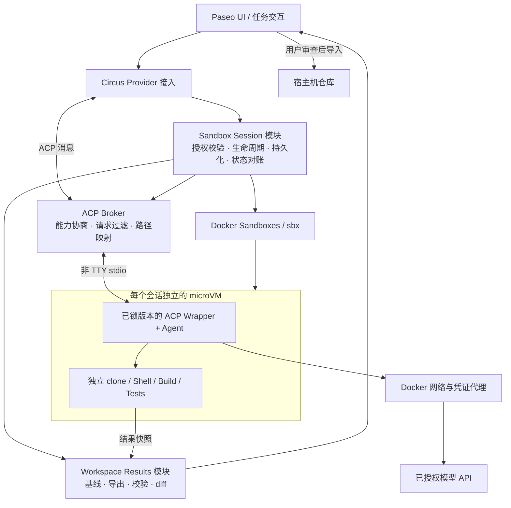

# Circus Hackathon 准备与架构评审

日期：2026-10-23。状态：讨论稿，以下为建议，尚未作为最终架构决策。

评审对象：[架构初稿 v0.1](circus-sandbox-architecture.md)。时间暂按初稿中的两天估计；团队人数和首发 Agent 尚未确定。本次完成文档与源码核验，没有安装运行时、运行 Agent 或执行安全验收。

## 1. 可行性判断与产品目标

**方向可行；两天交付成立的前提，是开工前验证执行链路，并且只支持一个 Agent、一种工作区模式和一个固定策略。** 初稿覆盖了目标架构，但把多个尚待验证的集成能力排进两天，实施风险偏高。

建议把产品目标写成：开发者从桌面发起代码任务，Agent 在受控环境中完成修改和测试，用户看清运行状态、授权范围与变更结果，再决定是否导入。

Circus 的价值集中在三个地方：把授权变成实际生效的执行配置；管理任务与沙箱的一致性；提供可审查、可取回的结果。Paseo 提供交互基础，Docker Sandboxes 提供隔离基础。

| 优先级 | 范围 | 验收方式 |
| --- | --- | --- |
| 必须 | 一个 Agent、一个干净的主 Git 仓库、独立沙箱 | 从 UI 完成代码修改与测试，源工作树没有被直接写入 |
| 必须 | 流式输出、多轮输入、取消、沙箱停止与删除 | 取消后 VM 内任务不继续运行；异常后能识别残留沙箱 |
| 必须 | 固定网络策略、代理凭证、关闭宿主机执行回路 | 同时验证允许路径与拒绝路径 |
| 必须 | 带基线的结果导出和审查 | 新增、修改、删除文件均可取回；首版可由用户手动导入 |
| 加分 | 一个已授权的远程 MCP、自动导入、第二个 Agent | 核心闭环稳定后再做 |
| 后续 | 完整原生 Provider 兼容、跨重启对话恢复、多工作区、通用策略编辑器 | 单独设计与验证 |

## 2. 已核验事实及其影响

本地 Circus 只有 README 与架构初稿；当前 shell 找不到 `sbx`。Paseo 核验使用上游提交 `582beeb10bf7a0dc2297f35529f78df89dee9358`，避免把动态 main 当作稳定契约。Docker 以下事实来自官方文档，仍需在团队最终锁定的版本实测。

### ACP 不能只做字节透传

Paseo ACP 客户端默认声明 `terminal: true`。其 `createTerminal` 处理器调用宿主机 `spawnProcess`；文件读写处理器也调用宿主机文件系统，尽管默认声明的文件能力为 false。[源码依据](https://github.com/getpaseo/paseo/blob/582beeb10bf7a0dc2297f35529f78df89dee9358/packages/server/src/server/agent/providers/acp-agent.ts#L2750)

因此，Agent 进程位于 VM 中，并不自动保证所有工具执行都位于 VM 中。Circus 必须控制双向 ACP：普通事件与权限询问可传到 UI；`terminal/*`、`fs/*` 等反向执行请求必须拒绝，或在对应 VM 内实现。不能只依赖能力声明来约束不可信对端。默认不透传未知扩展方法，也不自动把 Paseo 的宿主机 MCP、终端、浏览器和跨任务控制能力交给 Agent。

另一个容易遗漏的入口是模型发现：Paseo 的 ACP catalog 探测会创建会话，全局探测的 cwd 是宿主机 home。[源码依据](https://github.com/getpaseo/paseo/blob/582beeb10bf7a0dc2297f35529f78df89dee9358/packages/server/src/server/agent/providers/acp-agent.ts#L1091) 桥接程序不能把每次探测都当成一次真实任务，更不能从探测 cwd 推导工作区授权。建议将版本、可用性和 catalog 探测与真正的任务创建显式区分；若当前扩展方式做不到，使用专用 Provider 接入。仅配置静态模型列表是否能避免全部探测，需要验证。

### Claude 与 Codex 已有可评估的 ACP 包装器

该 Paseo 提交包含 `@agentclientprotocol/claude-agent-acp@0.31.4` 和 `@zed-industries/codex-acp@0.12.0` 的 smoke 测试定义。[源码依据](https://github.com/getpaseo/paseo/blob/582beeb10bf7a0dc2297f35529f78df89dee9358/packages/server/src/server/agent/providers/acp-wrapper-smoke.test.ts#L88)

这提供了路线 A 的具体起点；测试文件的存在不表示本次已经通过测试，也不表示其 VM 安装、凭证代理与取消行为已经兼容。先选一个包装器验证，不同时开发两套原生 Worker。

### Clone 模式与 Paseo worktree 流程存在冲突

Docker 官方 Usage 文档明确：`--clone` 不支持从主工作树以外的 Git worktree 创建，因为只读挂载无法解析其 `.git` 指针；clone 使用创建时源仓库的 ref，不自动创建新分支。[官方文档](https://docs.docker.com/ai/sandboxes/usage/#clone-mode)

首版从干净的主仓库启动，记录 `base_commit`，由 VM 内 clone 承担任务隔离。Paseo 此路径不再提前创建 Git worktree。若以后必须支持任意 worktree 和未提交改动，再加入输入快照或 mountless 导入。

Clone 的源仓库在 VM 的 `/run/sandbox/source` 仍可只读访问；不能把“独立 clone”描述成“源目录完全不可见”。带有 `.env` 或历史秘密的仓库仍需处理输入暴露范围。

### 凭证、网络与 MCP 要绑定实际配置

- 官方默认策略阻止未授权出站 TCP；实际允许项由本机和组织规则等决定。验收读取最终生效规则，不能只检查 Circus 中保存了一个 `policy_id`。[默认安全姿态](https://docs.docker.com/ai/sandboxes/security/defaults/)
- `sbx secret` 的服务凭证默认全局可用，也支持沙箱范围。凭证值与允许使用凭证的绑定是两个概念。OAuth kit 可启用 passthrough，使真实 token 进入沙箱，严格模式需要排除这种配置。[凭证文档](https://docs.docker.com/ai/sandboxes/configuration/credentials/)
- API Key 不可读取，仍不等于 Agent 无法调用付费接口；域名允许列表也不阻止向已允许服务发送项目数据。演示应准确限定保证范围。
- Docker Sandboxes 的本地 stdio MCP 在宿主机运行；注册服务器与把它加载到沙箱是两步操作。首版若接 MCP，使用显式选定的远程服务。[MCP 文档](https://docs.docker.com/ai/sandboxes/mcp-gateway/)
- 初稿中的 MCP 图应区分宿主机管理配置、Agent 访问的 Gateway 端点和 MCP 实际执行位置，避免把示意图解释成已核实的物理部署。

## 3. 建议的目标架构



这些是模块职责，不要求拆成独立服务。首版可把 Session、Broker 和 Results 放在一个宿主机程序内；通过 sbx 复用 VM、网络与凭证能力。

| 模块 | 对外承担的职责 | 内部必须隐藏的复杂性 |
| --- | --- | --- |
| Provider 接入 | 把 Paseo 的创建、输入、事件与取消映射到 Circus | UI 不直接拼 sbx 命令；区分探测和实际任务 |
| Sandbox Session | 创建/连接会话、观察状态、取消、停止、删除 | 唯一命名、幂等、创建失败回收、超时、进程退出、重启对账 |
| ACP Broker | 连接一个已授权会话的协议流 | 双向请求过滤、能力协商、JSON 流与 stderr 分离、请求关联、主机/VM 路径映射 |
| Workspace Results | 获取基线、导出结果、展示并导入 | 未提交与新增文件、冻结快照、路径检查、冲突检测、导出完成后才允许回收 |

Broker 只接收 Manager 授权的 `sandbox_id` 和 VM 工作区，不接受 Agent 提供任意宿主机路径。若所选 Agent 必须使用 ACP 客户端终端，终端实现转到 VM 内；首版优先选能使用 VM 内自身工具且接受关闭客户端终端能力的路径。

会话与 VM 分开建模：

```text
Sandbox: CREATING → READY ↔ STOPPED → REMOVED
         异常另记 ERROR / UNKNOWN，经运行时查询后对账

Turn:    IDLE → RUNNING → SUCCEEDED | FAILED | CANCELLED | INTERRUPTED
         一轮终止后，会话可接受下一轮

Result:  NONE → PENDING → EXPORTED → IMPORTED
         导出失败保留 PENDING，不以任务成功代替结果已保存
```

最小记录包含 `paseo_session_id`、`sandbox_id`、`agent_session_id`、源仓库、`base_commit`、VM 路径、Agent/包装器/镜像版本、策略配置及其核验状态、运行时观测状态和 `result_ref`。配置里的期望状态与实际观测状态需要区分。

取消一轮、停止 VM、删除 VM 是三个操作。杀掉宿主机 sbx 转发进程不等于 VM 内任务已停止，必须有 VM 内进程退出或 VM 停止的证据。恢复对话可后置，但启动时识别残留沙箱和保留结果属于首版要求。任何沙箱失败都不能自动退回宿主机执行。

## 4. Hackathon 开始前必须通过的验证

按下面顺序验证，每一步都留下版本、命令、结果和失败现象；活动规则若禁止赛前实现，则只做允许的环境准备与实验记录。

| 顺序 | 验证项 | 通过条件 | 未通过时的决策 |
| --- | --- | --- | --- |
| 1 | 演示机与运行时 | sbx 登录、创建/查询/停止/删除可用；明确平台要求；锁定 Paseo 提交与运行时版本 | 环境准备完成后再承诺桌面 VM Demo |
| 2 | 非 TTY 协议 | 已锁定包装器在 VM 内完成 initialize、new session、prompt、流式返回和第二轮输入；stdout 没有状态文字污染 | 限时排查，仍不通则选择 VM 内 TUI 演示并明确缩小集成范围 |
| 3 | 宿主机执行回路 | 直接构造 ACP terminal/fs/未知扩展请求也不能触发宿主机执行；catalog 探测不挂载 home、不生成长期沙箱 | 未关闭此回路前，不宣称具备 Circus 的安全执行闭环 |
| 4 | 凭证和网络 | 真实模型调用成功；运行时看不到真实 key；未授权目的地被拒绝；核实最终生效配置 | 缩小到可验证的服务与策略，禁止用明文 key 或默认全网放行兜底 |
| 5 | 工作区与结果 | 主仓库 clone 可修改；源工作树不变；能导出新增/修改/删除；基线正确 | 先做文件/patch 导出和人工导入，推迟自动导入 |
| 6 | 取消与失败 | 取消后 VM 内进程树停止；模拟连接丢失后仍能定位 VM 和取回结果 | 缩小恢复承诺，保留人工恢复入口，不能把未确认停止显示成已停止 |

第 2、3 步决定是否走 ACP 路线。原生 Provider Worker 应视为后续独立投入，不作为两天项目里临时加做的第二条完整路线。

## 5. 两天实施顺序

以下安排以开工前验证通过为前提；具体分工需根据人数调整。

| 时间 | 实施内容 | 当场可验收产物 |
| --- | --- | --- |
| Day 1 上午 | 实现最小 Session 模块和 Broker，复用验证过的启动配置 | 单个 UI 任务进入 VM，消息往返可用，能够取消 |
| Day 1 下午 | 接入 clone 基线、结果导出和任务/VM 双状态 | 一个真实代码任务闭环；能连续完成至少两次 |
| Day 2 上午 | 增加状态/策略摘要、diff 视图，补齐异常与清理 | 用户能解释任务在哪运行、能访问什么、结果在哪 |
| Day 2 下午 | 固定版本和演示样例，执行拒绝路径与失败恢复验收 | 可重复的 3–5 分钟演示与证据；有余量才接一个远程 MCP |

结果导出要覆盖新增文件，不能只调用一次 `git diff` 就认为完整；首版遇到二进制、子模块或超出支持范围的结果，明确标记并保留沙箱。导入前验证基线和当前仓库状态；冲突时保留导出产物，不强行覆盖。导出内容按不可信输入处理，不在宿主机执行其中的脚本或 hooks。

演示顺序建议：展示项目与授权范围 → 运行修改与测试 → 展示一条被拒绝的越界请求 → 展示结果与未被直接修改的源工作树 → 用户导入 → 停止/回收。用专门的无害 canary 文件验证隔离，不使用真实秘密。

## 6. 开工前需要定下来的三个选择

1. **首发 Agent：** Claude Code 或 Codex 选一个，以哪个包装器能通过完整验证为决策依据。
2. **首发工作区：** 建议只接受干净的主 Git 仓库；明确是否必须包含未提交内容和现有 worktree。
3. **演示重点：** 建议优先证明代码任务、隔离和结果回收；如果 MCP 是赛题核心，就替换部分 UI/自动导入工作量，而非继续叠加。

初稿下一版优先修改第 3 节（ACP 反向执行与探测）、第 4 节（worktree 限制与结果基线）、第 7 节（独立状态和身份映射）、第 8 节（赛前验证门槛与缩小后的 MVP）。
