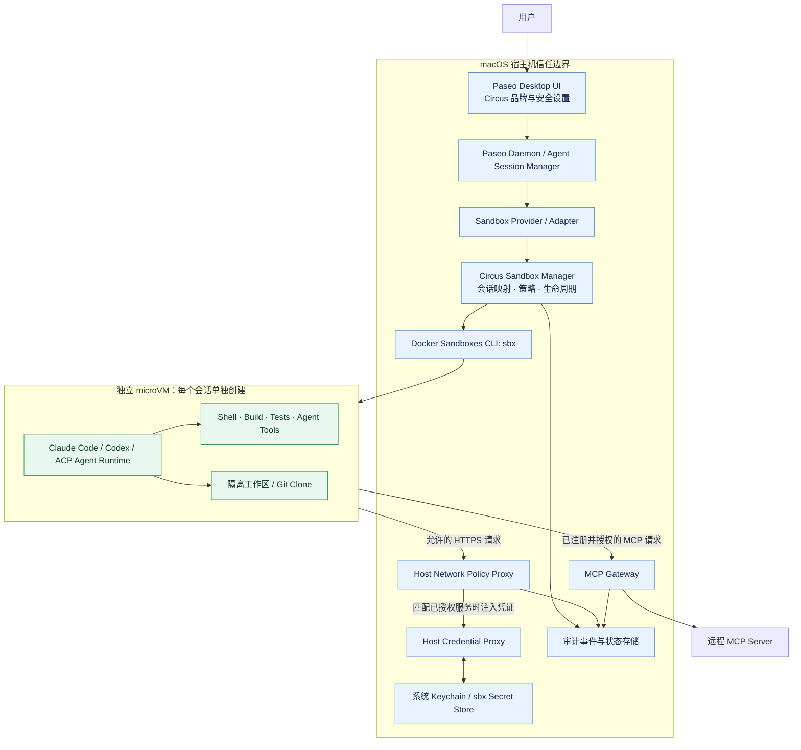
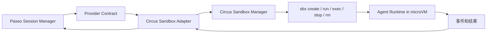
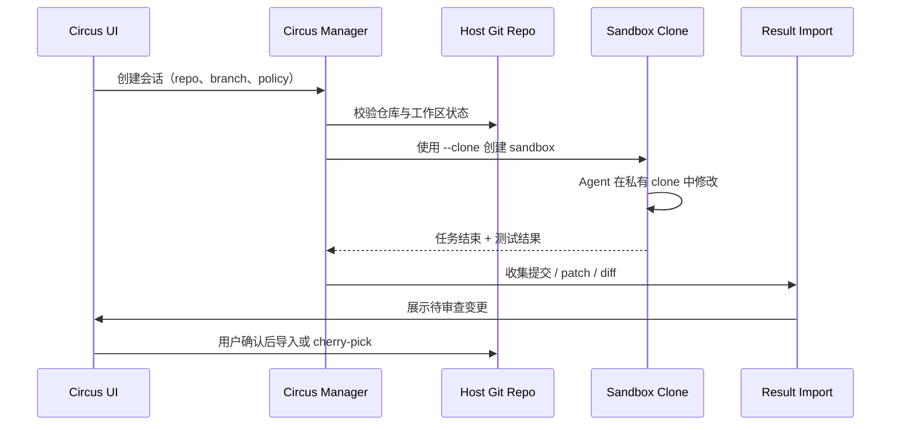
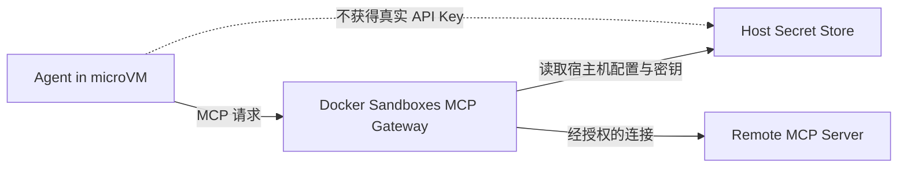

# Circus：桌面级 AI Agent 安全沙箱

> **文档类型：** Hackathon 技术方案 / MVP 设计\
> **版本：** v0.1\
> **日期：** 2026-10-23\
> **产品定位：** 以安全为第一优先级，让 Claude Code、Codex 等编码 Agent 和 MCP 工具在受控环境中工作，同时保留 Paseo 的桌面交互与任务管理体验。

---

## 1. 一页摘要

**Circus 不从零实现虚拟机、网络隔离或密钥代理。** 第一版优先复用 Paseo 的桌面端和会话 UI，并以 Docker Sandboxes 的 microVM 作为实际执行边界；Circus 自己补上执行适配、会话生命周期映射、工作区结果回收、安全策略与审计体验。

核心原则：

1. **Agent 代码执行在沙箱里。** 不只把 Paseo 主服务放进容器；Agent 的进程、工具执行和不可信代码都必须位于 microVM 内。
2. **不要把宿主机秘密复制进沙箱。** API Key 优先通过 `sbx` 的凭证代理和宿主机密钥存储注入；不挂载 `~/.ssh`、`~/.claude`、`~/.codex` 等完整配置目录来图省事。
3. **工作区按需暴露。** 强安全模式优先 Git Clone 工作区；避免默认把宿主机项目目录直接读写挂载给 Agent。
4. **默认拒绝外联。** 按域名或服务放行网络，MCP 也需要明确授权。
5. **不要误把 Provider 接口当成沙箱接口。** Paseo 的 ACP Provider 要求进程讲 ACP/JSON-RPC over stdio；`sbx run claude` 本身并不会自动变成 ACP Provider。Claude Code、Codex 的原生集成需要单独验证或开发协议桥接。

### MVP 目标

在两天内完成一个可演示的闭环：

- 从 Circus/Paseo UI 选择项目和 Agent，并发起任务。
- Circus 为会话创建独立沙箱，启动 Agent 并转发必要的交互和事件。
- Agent 能完成限定工作区内的代码任务。
- 原始 API Key 不对 Agent 进程可见；未经授权的外联被拒绝。
- 用户能查看任务状态、沙箱状态和变更结果，并能停止、删除沙箱。

### MVP 非目标

- 自研 hypervisor、内核级沙箱或容器运行时。
- 两天内完整支持所有 Agent、所有 MCP transport 和全部 Paseo 原生 Provider 能力。
- 把 UI 中展示的事件日志宣称为完整的系统级安全审计。

---

## 2. 总体架构



### 架构说明

- **Paseo UI / Daemon：** 尽量复用现有 UI、任务呈现、会话列表和 diff 体验。
- **Sandbox Provider / Adapter：** 负责把 Paseo 的会话协议转换为 Circus 的沙箱会话；不直接承担虚拟机安全实现。
- **Circus Sandbox Manager：** 管理 `session_id ↔ sandbox_id` 映射、创建参数、状态、取消和清理；避免把沙箱编排逻辑散落在 UI 中。
- **Docker Sandboxes：** 提供 microVM、隔离网络、独立 Docker Engine、工作区模式和宿主机凭证代理。
- **Credential Proxy / Keychain：** 真实凭证保留在宿主机；仅允许对已配置的目标服务进行代理注入。
- **MCP Gateway：** 统一注册远程 MCP、管理连接与密钥；不把任意本地 MCP 命令默认当作安全的。
- **Audit：** 记录 Circus 自己可观察到的创建、启动、停止、策略决策和结果导入事件。不能声称它覆盖了所有宿主机行为。

---

## 3. Paseo 集成方案

Paseo 的 Provider 抽象负责 Agent 启动方式、输出流、输入回传、模式和会话能力。当前公开文档区分原生 Provider 与 ACP 通用 Provider；ACP 使用 JSON-RPC 2.0 over stdio。

### 3.1 推荐分层



**不要直接修改现有 Claude/Codex Provider 的核心逻辑作为第一步。** 新增 Circus Adapter，保持普通本机 Provider 仍可使用，以便失败时回退。

### 3.2 关键技术判断：`sbx run claude` 不是现成的 Paseo Provider

Paseo 的 ACP Provider 要求其启动的子进程支持 ACP 协议。直接把命令配置为 `sbx run claude` 不足以满足这个条件：它启动的是沙箱中的 Agent 会话，不会自动把终端交互转换成 ACP 事件。

需要在开发前验证以下路线之一：

| 路线 | 做法 | 适合场景 | 风险 / 工作量 |
|---|---|---|---|
| **路线 A：ACP 沙箱桥接** | Paseo `extends: "acp"` 启动 `circus-sbx-acp`；桥接进程创建沙箱，并把 ACP 流路由到沙箱内的 ACP Agent | 最快验证 Paseo 扩展链路；适合支持 ACP 的 Agent | 必须确认 `sbx exec` 的非 TTY stdin/stdout 转发可用，且 Agent 在沙箱内可安装和启动 |
| **路线 B：Provider 专用 Worker** | 沙箱内运行 Claude/Codex Worker；宿主机桥接进程提供 Paseo 需要的协议和事件映射 | 目标是 Claude Code、Codex 的完整体验 | 工作量更大；需要处理权限、事件、流式输出、取消、恢复、工具结果等语义 |
| **路线 C：独立 TUI 演示** | Circus 创建沙箱后附加到 `sbx run` 终端会话 | 最短时间验证安全执行本身 | 不是完整的 Paseo 结构化会话集成，不应包装成已完成的 Provider 集成 |

**两天建议：** 先做 0.5 天技术 Spike，确认路线 A 或 B 至少一条可以稳定透传输入输出。若暂时无法把 Claude/Codex 原生协议完整接入，先交付明确标注为 MVP 的沙箱会话闭环，再继续完善结构化 Provider 适配，不要伪造“原生功能已全部兼容”。

### 3.3 Provider / Adapter 职责

- `CreateSession`: 校验项目、Agent、沙箱策略和可用凭证。
- `Launch`: 创建唯一沙箱并启动指定 Agent Runtime。
- `Input`: 把用户输入送达沙箱内 Agent，避免直接访问宿主机 Agent 进程。
- `StreamEvents`: 转发文本、工具状态、权限请求和错误；保持事件顺序。
- `Cancel`: 先结束 Agent 任务，再按策略保留或停止沙箱。
- `Resume`: 明确区分恢复现有沙箱会话和重新创建 Agent 会话；不能只凭 session ID 推断进程还活着。
- `CollectResult`: 汇总 diff、测试结果和必要日志。
- `Cleanup`: 删除临时工作区或沙箱；删除前先处理尚未导出的变更。

建议 Circus 内部最少定义这些状态：

```text
CREATING -> READY -> RUNNING -> SUCCEEDED
                     |   |-> FAILED
                     |   |-> CANCELLED
                     |   |-> INTERRUPTED
                     +------> STOPPING -> STOPPED
```

需把沙箱状态作为独立实体持久化；Paseo 的会话状态与 VM 运行状态并非同一个状态机。

---

## 4. 工作区管理

Workspace 是安全边界的一部分，而不只是一个路径参数。

### 模式对比

| 模式 | 行为 | 安全影响 | MVP 建议 |
|---|---|---|---|
| Direct Mount | 宿主机工作区以读写方式暴露给 Agent，文件修改立即反映到宿主机 | Agent 能删除或修改所挂载目录中的文件；不适合默认高安全配置 | 仅用于明确可信 Agent / 用户主动选择 |
| Git Clone (`--clone`) | 沙箱内使用独立 clone 工作；宿主机源仓库以只读形式提供 | 源工作树不被 Agent 直接写入；结果需 fetch / push / 导入 | **强安全模式默认选择** |
| Mountless | 不共享宿主机项目目录 | 隔离最好，但需要另外导入项目或补充只读输入 | 后续高安全模式 |

### Clone 模式的推荐流程



### 工作区约束

1. Agent 不应自动获得整个 `$HOME`、SSH 目录或其他项目目录。
2. 不把 `.env`、未跟踪的密钥文件、忽略文件当作“因为用了 clone 就一定安全”。Clone 模式保护的是宿主机源工作树的写入权限，不能替代敏感文件盘点和数据最小化。
3. 首版只允许一个主工作区；额外目录默认不挂载。确需参考资料时使用只读挂载。
4. 删除沙箱前，必须提示未导出的改动会丢失。
5. Git 导入应由用户确认；不要让 Agent 在未授权情况下直接推送生产分支。

---

## 5. 凭证、网络和 MCP 安全设计

### 5.1 凭证原则

- 使用 `sbx secret` / 支持的 OAuth 流程，把真实凭证保留在宿主机密钥存储中。
- 由宿主机代理向允许的 API 请求注入认证头；沙箱中的 Agent 不应读取真实 API Key。
- 不把 key 放进命令行参数、任务提示词、日志、环境文件或审计事件。
- 不直接挂载宿主机 `~/.claude`、`~/.codex`、`~/.ssh` 等目录；优先用受支持的 Agent Kit 和凭证代理。
- 针对不在内置服务清单中的 Provider，必须先验证代理、认证头注入和域名匹配行为。不要默认所有认证协议都能被透明代理。
- 注意 SSH Agent 转发：即使私钥文件没有进入 VM，沙箱进程若能访问转发的 agent socket，仍可能请求签名。严格模式应关闭不必要的转发。

### 5.2 网络策略

首版采取 allowlist：

- 默认拒绝未知外联。
- 允许模型 API、必要的软件包镜像和明确批准的业务服务域名。
- 包安装域名与运行时域名分别审核，避免安装脚本拥有不必要的凭证权限。
- 用户可以在任务开始前预览本次策略；被拒绝的访问在 UI 中显示目标主机和拒绝原因。
- 不应把“允许访问整个互联网”作为默认项。

### 5.3 MCP 接入



MCP 按来源分级：

| 类型 | MVP 策略 | 说明 |
|---|---|---|
| 可信远程 HTTP MCP | 优先支持，宿主机注册并明确授权给沙箱 | 推荐作为演示路径；使用 Gateway 管理认证与连接 |
| 本地 stdio MCP | 默认禁用；经过代码审查和独立隔离验证后再启用 | 不要把任意 `npx`、Shell 命令或用户自定义可执行文件自动作为宿主机进程运行 |
| 未知/社区 MCP | 默认拒绝 | 必须展示来源、目标域名、权限与密钥需求，再由用户明确批准 |

**重要限制：** Gateway 并不意味着所有本地 stdio MCP 的代码都自动运行在 Agent 的 microVM 中。远程 MCP 与本地 MCP 的执行边界不同；第一版以可信远程 MCP 为主。

---

## 6. 安全威胁模型

### 保护目标

- 宿主机文件系统（工作区授权范围以外）。
- macOS 用户凭证、API Key、浏览器会话、SSH 私钥及其他项目资料。
- 宿主机 Docker Daemon 与其他本地进程。
- 未经批准的网络目标和 MCP 工具。
- Paseo 中其他会话的工作区与状态。

### 主要威胁与对策

| 威胁 | 设计对策 | 仍需验证的边界 |
|---|---|---|
| 恶意 Agent 读取宿主机文件 | microVM + 最小工作区共享 + Clone 模式 | 显式挂载的目录仍是可访问面 |
| Agent 篡改用户原始代码 | Clone 模式，变更通过 Git review 导入 | 不要误把 clone 的只读源路径当成整个宿主机文件系统 |
| Agent 偷取 API Key | 宿主机凭证代理，密钥不写入 VM 文件/环境 | 自定义 Provider 和不支持的 OAuth 流必须单独验证 |
| Agent 通过网络外传数据 | 默认拒绝出站 TCP，按域名放行，记录策略事件 | 获准域名本身仍可能接收用户授权的数据 |
| 恶意 MCP 执行宿主机命令 | 首版只接入可信远程 MCP；本地 stdio 默认禁用 | Gateway 的注册方式并不自动证明 MCP 实现安全 |
| 通过 SSH Agent 发起签名 | 严格模式禁用转发或确保 socket 不暴露 | “私钥未复制”不等于“不能调用签名能力” |
| 会话取消后沙箱残留 | 独立状态机、启动超时、退出检测和定期清理 | 需要测试 daemon 崩溃与电脑睡眠后的恢复 |
| Agent 修改共享 Skills | 默认关闭共享 Skills 挂载，或限制为只读 | 需以实际 `sbx` 版本配置验证 |

### 安全声明边界

Docker Sandboxes 的 microVM 是主要隔离边界，但 Agent 在自己的 VM 内拥有较高权限，可以执行命令、安装软件和修改 VM 文件。安全方案的核心不是“Agent 在 VM 内没有权限”，而是“它不能越过明确划定的宿主机资源边界”。显式共享的工作区、Skills、SSH Agent 或网络出口会扩大该边界。

---

## 7. 数据模型与管理接口（建议）

### SandboxSession

```json
{
  "session_id": "paseo-session-id",
  "sandbox_id": "circus-<short-id>",
  "provider_id": "circus-sandbox-claude",
  "agent_id": "claude",
  "workspace_mode": "clone",
  "workspace_host_path": "/path/to/repo",
  "workspace_sandbox_path": "/path/to/repo",
  "policy_id": "locked-down-v1",
  "status": "RUNNING",
  "created_at": "ISO-8601",
  "last_seen_at": "ISO-8601",
  "result_ref": null
}
```

字段只表达运行状态，不保存任何凭证明文。

### 建议接口（Circus 内部抽象）

| 接口 | 职责 |
|---|---|
| `CreateSandboxSession(req)` | 检查参数与授权，创建 VM 和工作区 |
| `StartAgent(sessionID, agent, args)` | 在 VM 内启动 Agent Runtime |
| `SendInput(sessionID, payload)` | 转发用户消息或控制输入 |
| `SubscribeEvents(sessionID)` | 订阅输出、工具事件、权限请求与状态 |
| `CancelSession(sessionID)` | 结束当前任务，并按策略保留沙箱 |
| `ExportChanges(sessionID)` | 导出 diff / patch / commit 和测试结果 |
| `StopSandbox(sessionID)` | 停止运行中的 VM |
| `RemoveSandbox(sessionID)` | 清理 VM；删除前检查未导出结果 |

这些是推荐的 Circus 内部 API，不代表 `sbx` 本身提供同名接口。

---

## 8. 实施计划：两天 Hackathon

### Day 1：验证集成路径和执行安全

| 时间块 | 任务 | 交付物 / 验收 |
|---|---|---|
| 上午前段 | 安装并验证 `sbx`；用独立沙箱运行一个 Agent | 能创建、列出、停止、删除沙箱 |
| 上午后段 | 从 Paseo Provider 文档和当前源码确认启动契约；验证 ACP/stdio 透传或 Agent Worker 方案 | 明确一条端到端协议路径，不能只验证命令能启动 |
| 下午前段 | 实现 `Circus Sandbox Manager`：命名、状态映射、启动/停止/清理 | 同一个 session 可找到对应 sandbox；异常退出不产生无限孤儿进程 |
| 下午后段 | 配置 Clone 工作区、默认拒绝网络、验证凭证代理 | Agent 可编辑 clone；源工作树不被直接修改；原始 key 不出现在 VM 内 |

### Day 2：Paseo UI 闭环与安全演示

| 时间块 | 任务 | 交付物 / 验收 |
|---|---|---|
| 上午前段 | 新增 Circus Provider/Adapter，接入输入、输出、取消 | UI 可以发起任务、观察输出、停止任务 |
| 上午后段 | 接通结果回收与 diff | 结果可展示，用户能审查后再导入 |
| 下午前段 | 接入一个可信远程 MCP 与最小网络 allowlist | 被授权的 MCP 可调用，未授权目的地被拒绝 |
| 下午后段 | 跑攻击性验收用例、修复演示阻塞问题、准备 Demo | 具备可重复演示的安全成功路径和阻断路径 |

### MVP 验收清单

- [ ] UI 发起任务会创建独立 sandbox，而非本机直接启动 Agent。
- [ ] 每个会话能映射到唯一 sandbox，重复启动不会误连其他会话。
- [ ] Agent 输出可流式显示；输入、取消和退出状态正常。
- [ ] 强安全模式使用 Clone 工作区，宿主机源工作树没有被 Agent 直接写入。
- [ ] Agent 无法读取显式授权工作区以外的宿主机文件（按设计测试边界执行）。
- [ ] Agent VM 内查不到真实 API Key；日志和进程参数中不包含明文密钥。
- [ ] 不在 allowlist 的网络目标被拒绝，并在 Circus 中有明确状态或提示。
- [ ] 一个可信远程 MCP 可正常工作；本地未知 MCP 默认不被执行。
- [ ] 用户停止任务后，沙箱状态可预测；删除前不会静默丢弃未导出的变更。
- [ ] 验收文档清楚区分已经实现的能力和暂未实现的能力。

---

## 9. Demo 脚本建议

1. 用户在 Circus 中选择 Git 项目、`Claude Code`（或首个已通过协议验证的 Agent）和“强安全模式”。
2. Circus 展示即将创建的沙箱、Clone 工作区策略、允许的网络域名和 MCP 列表。
3. Agent 完成一个小型代码修改并运行测试。
4. Circus 展示任务事件、测试结果和待审查 diff；宿主机原始工作树没有被直接修改。
5. 尝试读取工作区之外的宿主机敏感文件，访问被禁止的网络域名：请求被隔离边界或网络策略阻断。
6. 调用一个已授权的远程 MCP；展示工具能工作，而原始密钥没有直接提供给 Agent。
7. 用户审查变更后导入结果，随后停止或删除沙箱。

> 演示用敏感文件应为专门创建的无害测试文件，不要用真实 API Key、个人文件或生产凭证做攻击演示。

---

## 10. 主要风险与决策点

1. **Agent 协议桥接是首要风险。** 必须先证实 Paseo 能与沙箱内 Agent 双向通信；`sbx run` 命令可用并不等同于 Provider 集成完成。
2. **Claude/Codex 的原生集成需要单独适配。** ACP 是一种可行路线，但必须确认目标 Agent 在沙箱里支持 ACP，或实现对应的 Worker/协议映射。
3. **工作区体验与安全有取舍。** Direct Mount 对 diff 最方便；Clone 更安全，但需要额外的结果回收和 review 流程。
4. **凭证代理并非万能。** 只对支持的服务、域名和认证模式起作用；不支持的服务不能退化为把明文 key 直接放进沙箱。
5. **MCP 扩展要分阶段。** 先支持可信远程 MCP，再评估本地 stdio MCP 的启动与隔离方式。
6. **Paseo 升级可能影响扩展。** Provider 配置与内部 SDK 的行为需要锁定依赖版本，并为适配层写集成测试。

### 推荐决策

**先复用 Paseo UI、Docker Sandboxes 的 microVM/网络/凭证能力；新增 Circus Adapter 和 Sandbox Manager；默认 Clone + 网络 allowlist + 可信远程 MCP。** 首个里程碑必须以“Agent 的工具执行实际在 microVM 中发生”为验收标准，而不是只看 UI 或沙箱命令是否启动成功。

---

## 11. 参考资料

### Paseo

- [Paseo Providers：Provider 心智模型和扩展概念](https://github.com/getpaseo/paseo/blob/main/public-docs/providers.md)
- [Paseo Custom Providers：自定义 Provider、命令覆盖和 ACP 配置](https://github.com/getpaseo/paseo/blob/main/public-docs/custom-providers.md)
- [Paseo Providers（源码仓库开发文档）](https://github.com/getpaseo/paseo/blob/main/docs/providers.md)
- [Paseo GitHub Repository](https://github.com/getpaseo/paseo)

### Docker Sandboxes

- [Security Model](https://docs.docker.com/ai/sandboxes/security/)
- [Isolation Layers](https://docs.docker.com/ai/sandboxes/security/isolation)
- [Usage：启动、停止、exec、工作区和 Clone 模式](https://docs.docker.com/ai/sandboxes/usage/)
- [Credentials：Secret Store、凭证代理与 OAuth](https://docs.docker.com/ai/sandboxes/configuration/credentials)
- [MCP Gateway：注册 MCP 和向沙箱暴露服务](https://docs.docker.com/ai/sandboxes/mcp-gateway/)
- [Default Security Posture](https://docs.docker.com/ai/sandboxes/security/defaults/)

---

## 附录 A：手动验证命令

> 以下是工程验证命令，不是最终 Circus 内部 API。实际参数应以团队使用的 `sbx` 版本为准。

```bash
# 验证环境 / 登录
sbx login

# 启动 Agent 沙箱（当前目录会作为工作区）
sbx run claude

# Git 仓库建议测试 Clone 模式
sbx run --clone claude .

# 查看沙箱
sbx ls

# 对一个已存在的沙箱执行命令
sbx exec <sandbox-name> bash -lc 'pwd && git status --short'

# 停止或移除沙箱
sbx stop <sandbox-name>
sbx rm <sandbox-name>

# 查看并配置 MCP（示例服务器必须替换成真实且可信的地址）
sbx mcp ls
# sbx mcp add <name> --url https://<trusted-mcp-host>/mcp
```

**注意：** Clone 模式要求主工作区是 Git 仓库；直接挂载模式会把工作区读写暴露给 Agent。`sbx run`、`sbx exec` 的命令行能力仅用于验证执行环境，不代表已经解决 Paseo Provider 的流式协议适配。
